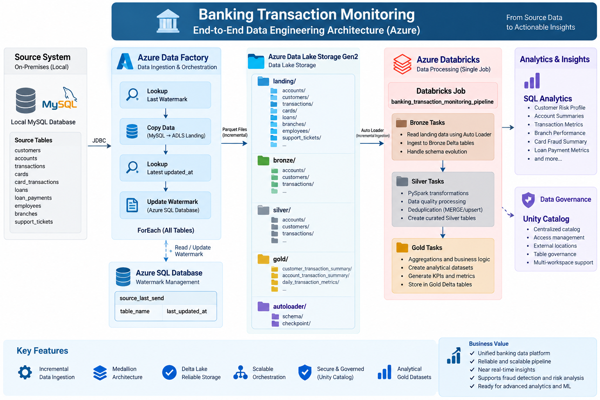
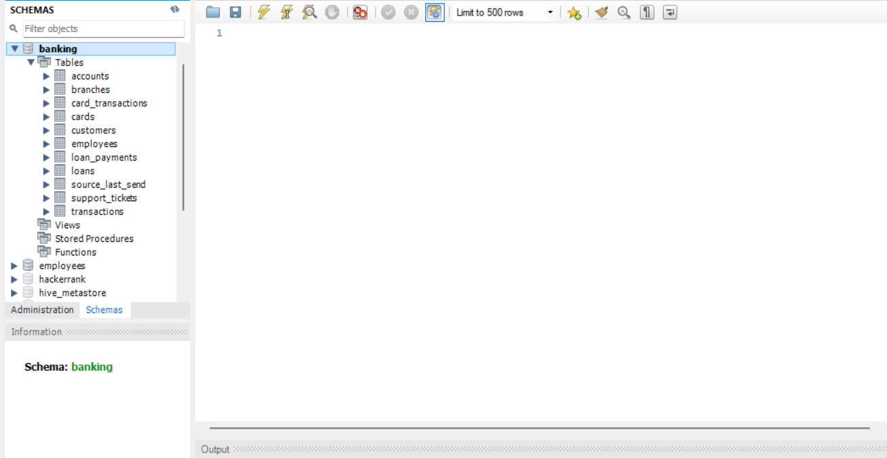
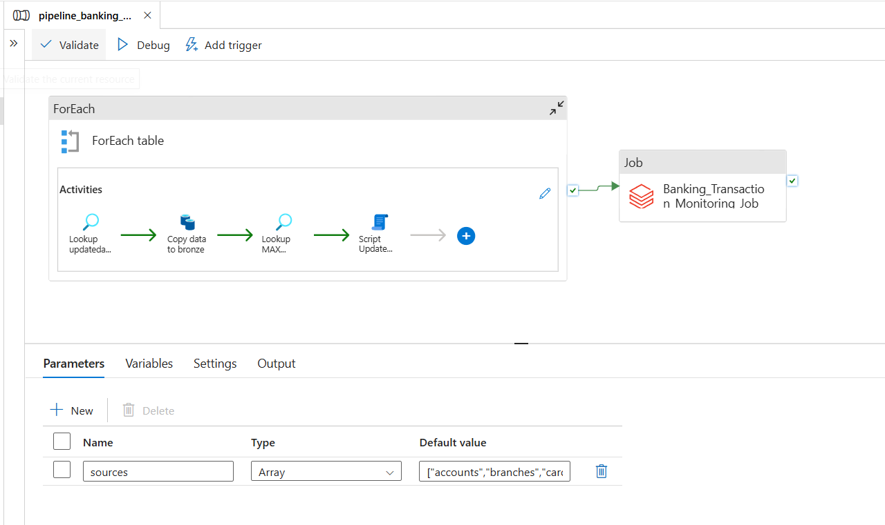
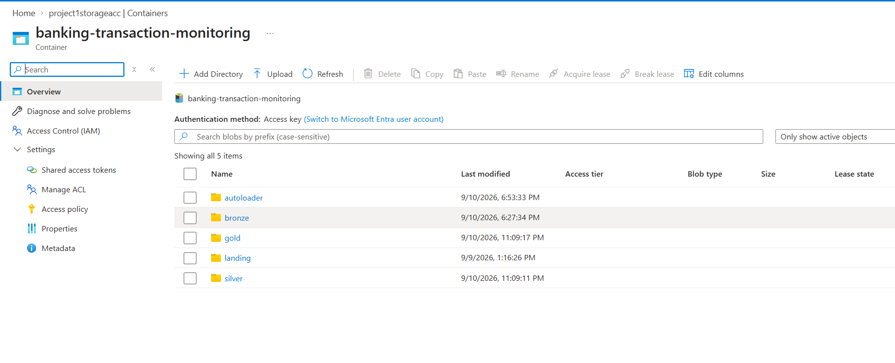
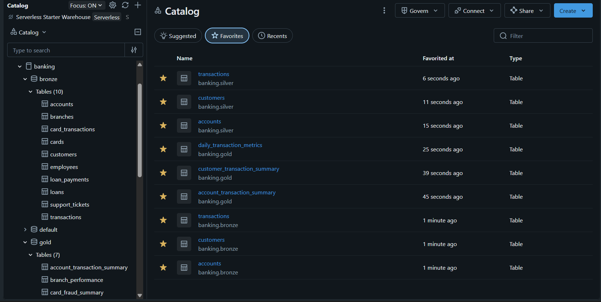
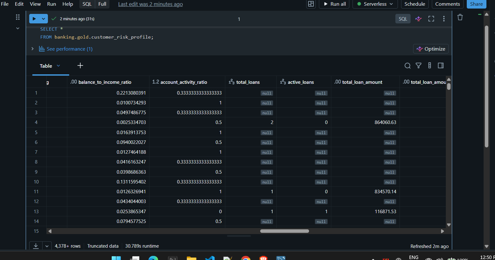
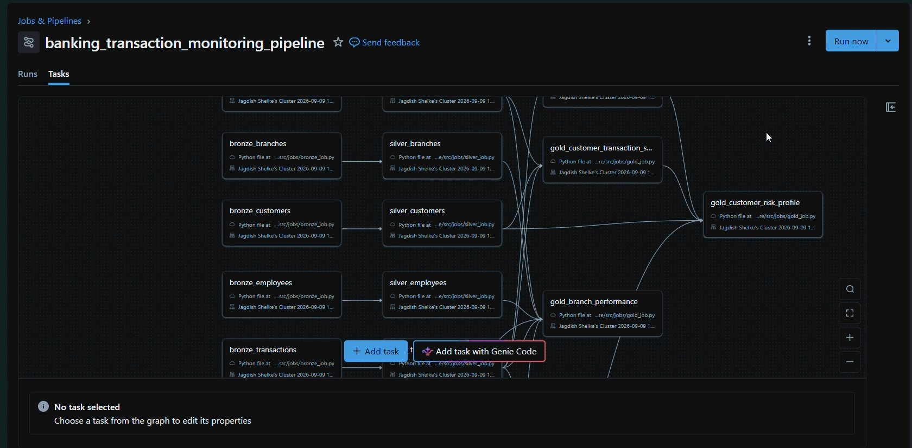
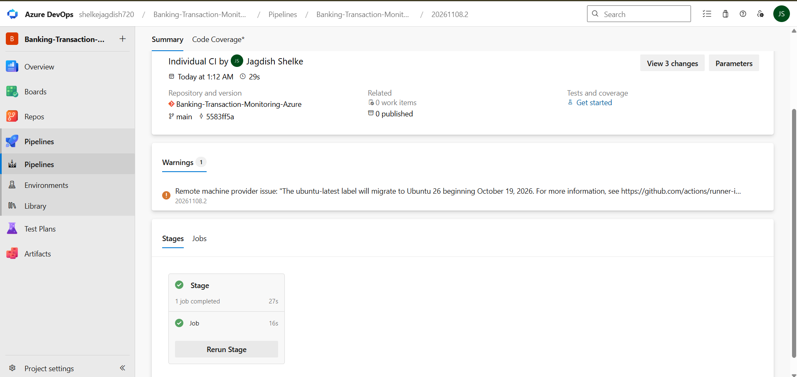

# Banking Transaction Monitoring -- Azure

A cloud-based banking data engineering project implementing an
end-to-end ETL/ELT pipeline using Azure Data Factory, Azure Data Lake
Storage Gen2, Azure Databricks, Auto Loader, Delta Lake, and Unity
Catalog.

The project demonstrates initial and incremental data ingestion,
Medallion Architecture (Landing → Bronze → Silver → Gold), PySpark
transformations, data quality processing, Delta Lake MERGE/upsert
patterns, and analytical Gold datasets.

## 📊 Dataset

This project uses the **Banking Transactions Dataset** from Kaggle:

https://www.kaggle.com/datasets/vivekmali1436/banking-transactions-dataset

The dataset contains:

-   Customers
-   Accounts
-   Transactions
-   Cards
-   Card Transactions
-   Loans
-   Loan Payments
-   Employees
-   Branches
-   Support Tickets

## 🏗️ Architecture



``` text
Banking Transactions Dataset
            |
            v
        CSV Files
            |
            v
     Local MySQL Source
            |
            | ADF + Self-Hosted IR
            v
      ADLS Gen2 Landing
            |
            | Databricks Auto Loader
            v
       Bronze Delta
            |
            | PySpark + Data Quality
            v
       Silver Delta
            |
            | Joins + Aggregations
            v
        Gold Delta
```

## 1. Source System -- Local MySQL



The dataset CSV files are loaded into source tables in a local Windows
MySQL database.

Source tables:

``` text
customers
accounts
transactions
cards
card_transactions
loans
loan_payments
employees
branches
support_tickets
```

The files are loaded using MySQL:

``` sql
LOAD DATA LOCAL INFILE
```

This provides a relational source system for the Azure ingestion
pipeline.

## 2. Initial and Incremental Loads

The dataset is divided into three loads:

``` text
Initial_Load
Incremental_Load
Incremental_Load
```

The initial load represents the starting dataset. The two incremental
loads represent subsequent source changes/new data.

The incremental files are loaded into MySQL and then processed through
the same downstream pipeline.

``` text
Initial / Incremental CSV
          |
          v
      Local MySQL
          |
          v
         ADF
          |
          v
    ADLS Landing
```
## 3. Incremental Load Watermark – Azure SQL Database

An Azure SQL Database is used to maintain the source-to-target incremental load watermark.
A control table named source_last_send stores the last successfully processed updated_at value for each source table.

``` text
Azure SQL Database
        |
        v
source_last_send
        |
        | Lookup last processed timestamp
        v
Azure Data Factory
        |
        | Query MySQL for new/updated records
        v
ADLS Gen2 Landing
```
The watermark is used by ADF to identify and load only new or modified
records from the local MySQL source.

## 4. Azure Data Factory



Azure Data Factory is used to extract data from the local MySQL source
and copy it to ADLS Gen2.

A **Self-Hosted Integration Runtime (SHIR)** provides connectivity
between Azure Data Factory and the local Windows/MySQL environment.

``` text
Local MySQL
     |
     | Self-Hosted Integration Runtime
     v
Azure Data Factory
     |
     | Lookup watermark from Azure SQL Database
     |
     | Fetch new/updated records
     v
ADLS Gen2 Landing
```

ADF is responsible for:

-   Reading MySQL source tables
-   Processing initial and incremental loads
-   Looking up the last processed watermark
-   Fetching new/updated records using updated_at
-   Copying data to ADLS Landing
-   Updating the watermark after successful ingestion
-   Managing source-to-landing ingestion

## 5. ADLS Gen2 Storage



ADLS Gen2 is used as the data lake storage layer.

The storage is organized into:

``` text
banking-transaction-monitoring/
│
├── landing/
│   ├── accounts/
│   ├── customers/
│   ├── transactions/
│   └── ...
│
├── bronze/
│   ├── accounts/
│   ├── customers/
│   ├── transactions/
│   └── ...
│
├── silver/
│   ├── accounts/
│   ├── customers/
│   ├── transactions/
│   └── ...
│
├── gold/
│   ├── account_transaction_summary/
│   ├── customer_transaction_summary/
│   └── ...
│
└── autoloader/
    ├── schema/
    └── checkpoint/
```

## 6. Bronze Layer



Bronze stores the incoming data as Delta tables with minimal
transformation.

Unity Catalog tables follow:

``` text
banking.bronze.<table_name>
```

Examples:

``` text
banking.bronze.accounts
banking.bronze.customers
banking.bronze.transactions
```

The Bronze tables are external Delta tables stored in ADLS Gen2. A Unity
Catalog External Location is configured for the Bronze storage path.

### Landing → Bronze

Databricks Auto Loader reads newly arriving Parquet files from the ADLS
Landing layer.

``` text
ADLS Landing
     |
     | Auto Loader / cloudFiles
     v
Bronze Delta Tables
```

Auto Loader is used for:

-   Incremental file discovery
-   Schema inference
-   Schema evolution
-   Checkpoint-based processing
-   Processing newly arrived files

Separate schema and checkpoint locations are maintained for Auto Loader
processing.

## 7. Silver Layer

The Silver layer contains cleaned and transformed Delta tables.

Tables follow:

``` text
banking.silver.<table_name>
```

Examples:

``` text
banking.silver.accounts
banking.silver.customers
banking.silver.transactions
```

Transformations include:

-   Removing unwanted columns
-   Handling NULL values
-   Trimming strings
-   Standardizing case
-   Date validation
-   Numeric validation
-   Boolean validation
-   Data-quality filtering
-   Deduplication
-   Keeping the latest record using the primary key and `updated_at`
-   Standardizing source values

### Bronze → Silver

``` text
Bronze Delta
     |
     | readStream
     v
PySpark Transformations
     |
     | Data Quality
     | Deduplication
     | Standardization
     v
Silver Delta
```

Silver upserts use Delta Lake `MERGE` through `foreachBatch`, allowing
the latest version of a record to be maintained by primary key.

## 8. Gold Layer

The Gold layer contains business-oriented analytical Delta tables.

Gold processing reads Silver tables, performs joins and aggregations,
and produces datasets for reporting, monitoring, and analysis.

``` text
Silver Delta Tables
        |
        | Joins + Aggregations
        v
Gold Delta Tables
```

Tables follow:

``` text
banking.gold.<table_name>
```

## 📈 Gold Tables

### `account_transaction_summary`

Sources:

``` text
Silver accounts
Silver transactions
```

Account-level transaction metrics including transaction counts, amounts,
credit/debit activity, and net transaction amount.

### `customer_transaction_summary`

Sources:

``` text
Silver customers
Silver accounts
Silver transactions
```

Customer-level transaction and account activity metrics.

### `daily_transaction_metrics`

Sources:

``` text
Silver transactions
```

Daily transaction metrics including transaction counts, amounts,
credit/debit activity, and unique accounts/channels.

### `loan_payment_metrics`

Sources:

``` text
Silver loans
Silver loan_payments
```

Loan-level payment metrics including amount paid, principal, interest,
late payments, payment rates, and remaining principal.

### `card_fraud_summary`

Sources:

``` text
Silver cards
Silver card_transactions
```

Card-level transaction and fraud metrics including fraud counts,
amounts, rates, merchant categories, and fraud flags.

### `branch_performance`

Sources:

``` text
Silver branches
Silver accounts
Silver transactions
Silver loans
Silver employees
Gold loan_payment_metrics
```

Branch-level customer, account, transaction, loan, payment, and employee
performance metrics.

### `customer_risk_profile`



Sources:

``` text
Silver customers
Gold account_transaction_summary
Gold customer_transaction_summary
Gold loan_payment_metrics
```

Customer-level risk metrics including transaction activity, account
activity, loan exposure, payment behavior, risk score, risk level, and
risk reason.

## ⚙️ Orchestration

The complete data pipeline is orchestrated using **Azure Data Factory** and a
single **Azure Databricks Job**.



```text
1. Azure Data Factory
   MySQL → ADLS Gen2 Landing
          |
          | ForEach Table
          | - Lookup watermark
          | - Copy new/updated records
          | - Lookup latest updated_at
          | - Update watermark
          |
          | After ForEach completes successfully
          v
2. Azure Databricks Job
   banking_transaction_monitoring_pipeline
          |
          +--> Bronze Tasks
          |    Landing → Bronze
          |
          +--> Silver Tasks
          |    Bronze → Silver
          |
          +--> Gold Tasks
               Silver → Gold
```

Databricks jobs are parameterized by table name, allowing the same
modular PySpark jobs to process multiple source tables.

Example:

``` text
--table accounts
--table customers
--table transactions
```

## 🔄 CI/CD & Deployment via Databricks Asset Bundles (DAB)



To ensure production parity, prevent UI drift, and eliminate manual deployments, code and workflow configurations are managed as Infrastructure as Code (IaC) using **Databricks Asset Bundles (DAB)** and deployed automatically through **Azure DevOps Pipelines**.

```text
[ Git Repo: main ]
       │
       ▼ (Automated Git Push / PR Merge)
[ Azure DevOps CI/CD Pipeline ]
       │
       │ (Authenticates via Entra ID Service Principal)
       ▼
[ Databricks CLI / DAB Engine ]
       │
       ├─► Validates Bundle Config (databricks bundle validate)
       ├─► Syncs Source Files (/Workspace/Shared/.../prod/files/)
       └─► Deploys / Updates Workflow DAG (banking_transaction_monitoring_pipeline)
```

## 🧩 Technology Stack

| Technology | Purpose |
|------------|---------|
| Python | ETL/application code |
| PySpark | Data transformation |
| MySQL | Local source database |
| Azure Data Factory | Source-to-Landing ingestion |
| Self-Hosted Integration Runtime | Local MySQL connectivity |
| ADLS Gen2 | Data lake storage |
| Azure Databricks | Data processing |
| Auto Loader | Incremental file ingestion |
| Delta Lake | Reliable table storage |
| Unity Catalog | Catalog and access management |
| SQL | Source and analytical queries |
| Databricks Asset Bundles (DAB) | Infrastructure & Workflow as Code
| Azure DevOps Pipelines | Automated CI/CD build & deployment
| Microsoft Entra ID (Azure AD) | Service Principal automated authentication
| Git/Azure Repos | Version control


## 🛡️ Key Data Engineering Concepts Demonstrated

-   Medallion Architecture
-   ETL/ELT pipeline design
-   Initial and incremental ingestion
-   Azure Data Factory
-   Self-Hosted Integration Runtime
-   ADLS Gen2
-   Databricks Auto Loader
-   Delta Lake
-   Unity Catalog
-   Streaming DataFrames
-   `foreachBatch`
-   Delta `MERGE`
-   Window-function-based deduplication
-   Schema inference and evolution
-   Data quality transformations
-   External Delta tables
-   Parameterized Databricks jobs
-   Modular PySpark application design
-   Databricks Asset Bundles (DAB)
-   CI/CD Pipeline Design using Azure DevOps
-   Git / Azure Repos version control

## 🚀 End-to-End Flow

``` text
                         BANKING DATASET
                                |
                                v
                           CSV FILES
                                |
                                v
                         LOCAL MYSQL
                                |
                                | ADF + SHIR
                                v
                         ADLS LANDING
                                |
                                | AUTO LOADER
                                v
                         BRONZE DELTA
                                |
                                | PYSPARK
                                | DATA QUALITY
                                | DEDUPLICATION
                                v
                         SILVER DELTA
                                |
                                | JOINS
                                | AGGREGATIONS
                                v
                          GOLD DELTA
                                |
                                v
                    ANALYTICAL DATASETS
```

## 📌 Repository

This repository contains the Azure implementation of the Banking
Transaction Monitoring project:

``` text
Banking-Transaction-Monitoring-Azure
```

The Azure implementation is maintained separately from the original
on-premise Hadoop/Hive implementation.